# FIS LabPréstamos · Caso 1

**Sistema Web de Gestión de Préstamos de Equipos de Laboratorio**  
Universidad Nacional del Centro del Perú · Facultad de Ingeniería de Sistemas  
Práctica Semana 12 · Desarrollo de Aplicaciones Web

## Alcance

Este repositorio implementa **exclusivamente el Caso 1** de la guía. Proyecto individual, interfaz institucional formal en azul, amarillo y plomo, sin emojis ni dependencias de imágenes. Está desarrollado con Django 5.2 y SQLite.

### Funcionalidades

- Catálogo público con búsqueda, filtros y stock disponible.
- Panel según rol: administrador, docente y asistente.
- Administración de equipos: código patrimonial, marca, modelo, categoría, laboratorio, stock, estado, mantenimiento; indicadores calculados y acción masiva de mantenimiento.
- Solicitud de préstamo por docente y registro directo por asistente.
- Validaciones en formularios y modelo: máximo **3 préstamos o solicitudes vigentes** por docente, fechas coherentes, equipo operativo, stock suficiente; observaciones sin etiquetas HTML.
- Entrega y devolución exclusiva por asistentes, con registro de condición al retornar.
- Registro de eventos críticos: usuario, fecha/hora, IP, tipo de acción y detalle; detección de accesos denegados.
- Alerta de préstamos vencidos para docentes al comenzar una sesión.
- Django Admin personalizado: filtros, búsquedas, campo de días de retraso, acciones masivas de mantenimiento y recordatorio **interno**.
- Reportes por laboratorio y docente, y auditoría restringidos a administradores.
- CSRF, contraseñas cifradas por Django, cookies de sesión HttpOnly, timeout deslizante de 30 minutos, uso de `select_related`.
- Datos demo: **5 usuarios, 5 laboratorios, 10 equipos y 15 préstamos** (10 históricos y 5 activos).

## Requisitos

- Python 3.11 o superior
- Windows PowerShell, Git Bash o terminal similar
- Conexión a Internet al instalar Django desde pip

## Instalación en Windows (PowerShell)

```powershell
# Descomprimir el ZIP y abrir una terminal en la carpeta labprestamos_uncp
py -m venv .venv
.\.venv\Scripts\Activate.ps1
python -m pip install -r requirements.txt
python manage.py makemigrations prestamos
python manage.py migrate
python manage.py cargar_demo --password "Cambiar2026!"
python manage.py runserver
```

Si PowerShell impide activar el entorno, puede ejecutar `\.venv\Scripts\python.exe` delante de cada comando o usar CMD/Git Bash.

**Git Bash:**

```bash
python -m venv .venv
source .venv/Scripts/activate
python -m pip install -r requirements.txt
python manage.py makemigrations prestamos
python manage.py migrate
python manage.py cargar_demo --password 'Cambiar2026!'
python manage.py runserver
```

- Catálogo: http://127.0.0.1:8000/
- Ingreso: http://127.0.0.1:8000/cuentas/ingresar/
- Administración: http://127.0.0.1:8000/admin/

## Usuarios de demostración

| Usuario | Rol | Clave temporal demo |
|---|---|---|
| adminfis | Administrador | Cambiar2026! |
| docente01 | Docente | Cambiar2026! |
| docente02 | Docente | Cambiar2026! |
| asistente01 | Asistente | Cambiar2026! |
| asistente02 | Asistente | Cambiar2026! |

**Solo para pruebas locales.** No publicar las credenciales, cambiar las contraseñas para otro entorno y configurar una clave secreta y HTTPS antes de desplegar. `cargar_demo` es idempotente para usuarios/equipos; los préstamos solo se generan si la tabla está vacía. No modifica contraseñas de cuentas existentes.

## Flujos de uso

1. **Invitado:** visualiza el catálogo sin iniciar sesión.
2. **Docente:** inicia sesión, solicita un equipo, revisa estado e historial propio. La solicitud queda pendiente y reserva stock.
3. **Asistente:** puede aprobar/entregar solicitudes pendientes, crear préstamos directos y registrar devoluciones. Al devolver, el stock reservado queda liberado.
4. **Administrador:** controla equipos y usuarios desde Django Admin; revisa reportes y auditoría desde la web. Los préstamos en Django Admin son de solo lectura para proteger la trazabilidad.

## Decisiones de implementación

- La guía menciona “login con credenciales institucionales”; este proyecto **no integra el servicio real de identidad de la UNCP** porque no se proporcionó acceso a SSO/LDAP. Los nombres de usuario institucionales se administran localmente mediante Django Auth.
- El recordatorio masivo del administrador se **registra en la auditoría**, sin fingir un envío real de correos. Para correo institucional real se necesita configurar SMTP y autorización.
- El límite de 3 incluye solicitudes pendientes y préstamos activos para impedir que múltiples solicitudes superen el límite al entregarse.
- Cada equipo registrado maneja un stock de unidades iguales (cantidad) y las solicitudes pendientes consumen disponibilidad.
- Un préstamo puede contener varias unidades iguales y la devolución registra su condición de forma conjunta.
- El inventario y las solicitudes utilizan transacciones atómicas. En producción con concurrencia alta se recomienda PostgreSQL con bloqueo de filas real; SQLite no implementa `SELECT FOR UPDATE`.
- Este es un proyecto académico ejecutable localmente, no una plataforma institucional desplegada.

## Pruebas automatizadas

```bash
python manage.py test
python manage.py check
```

Cobertura básica: acceso público, privacidad del historial docente, permiso de devolución, límite de tres préstamos, control de stock, fechas válidas y reportes restringidos.

## Estructura

```text
labprestamos_uncp/
  config/                       Configuración y rutas globales
  prestamos/                    Modelos, vistas, formularios, permisos y middleware
    management/commands/        Carga de datos demostrativos
    migrations/                 Se genera la migración inicial al instalar
  templates/                    Interfaces HTML del sitio
  static/css/                   Diseño institucional sin imágenes
  manage.py
  requirements.txt
  README.md
  capturas/                    Evidencias de funcionamiento (21 imágenes)
```

## Evidencias

Las siguientes capturas documentan el funcionamiento del Caso 1. Los archivos se ubican en la carpeta `capturas/` y se muestran en el mismo orden que las pruebas realizadas. Para que GitHub las renderice, deben conservar exactamente los nombres indicados (incluidas las mayúsculas y la extensión `.png`).

Este proyecto **no incluye capturas ni evidencias** porque serán realizadas por la estudiante. Las vistas y el panel Django Admin permiten generar las capturas correspondientes a la guía.

## 8. CASO 1: SISTEMA DE GESTIÓN DE PRÉSTAMOS DE EQUIPOS DE LABORATORIO

Evidencias visuales de las funcionalidades y validaciones del sistema. Las capturas se almacenan en la carpeta `capturas/`.

### 8.1. VISTA GENERAL

Vista general del sistema de gestión de préstamos de equipos de laboratorio.

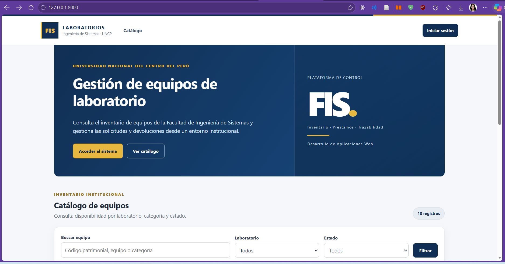

### 8.1.1. INVENTARIO INSTITUCIONAL

Visualización del inventario institucional y los equipos registrados.

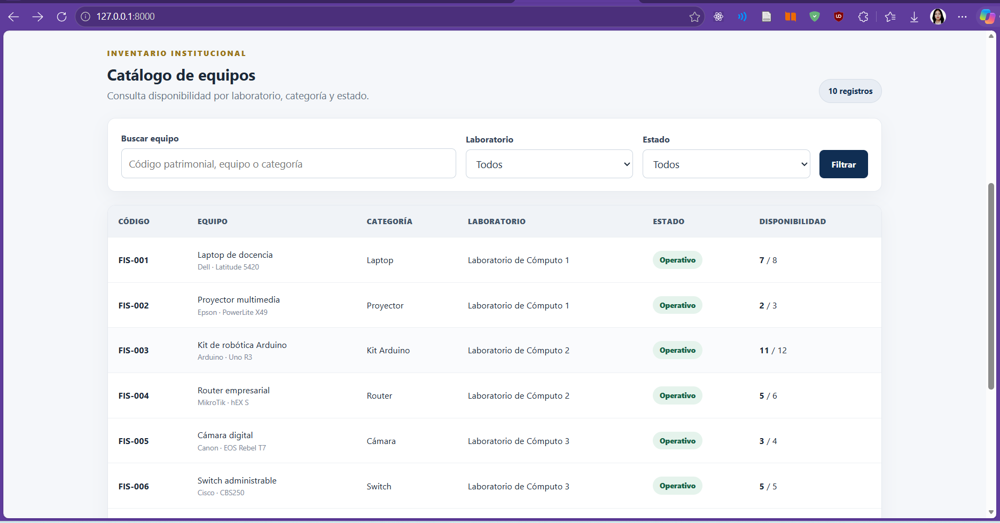

### 8.1.2. PRUEBA DE FILTROS

Búsqueda y filtrado de equipos disponibles en el catálogo.

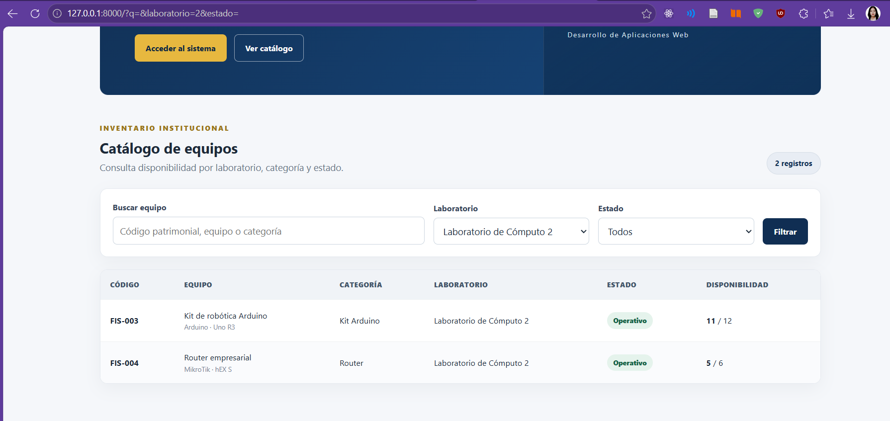

### 8.1.3. USUARIOS DE PRUEBA

Usuarios de prueba configurados para evaluar los diferentes roles del sistema.

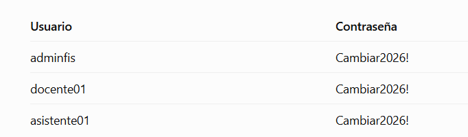

### 8.2. INICIAR SESIÓN

Formulario de autenticación de usuarios.

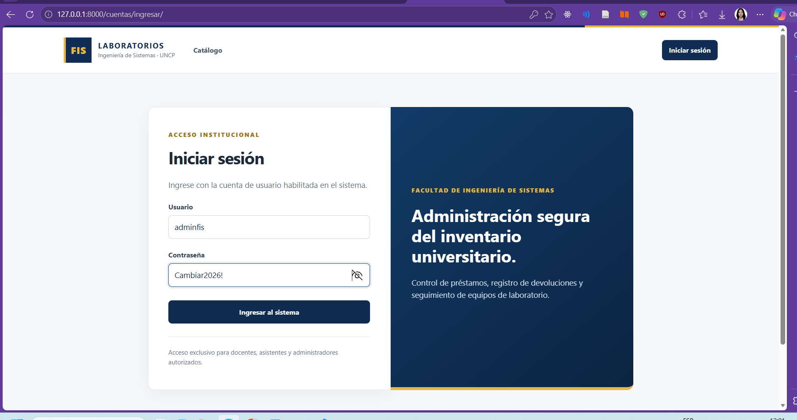

### 8.2.1. PANEL DE CONTROL DE ADMINISTRADOR

Panel principal del administrador con acceso a las funcionalidades de gestión.

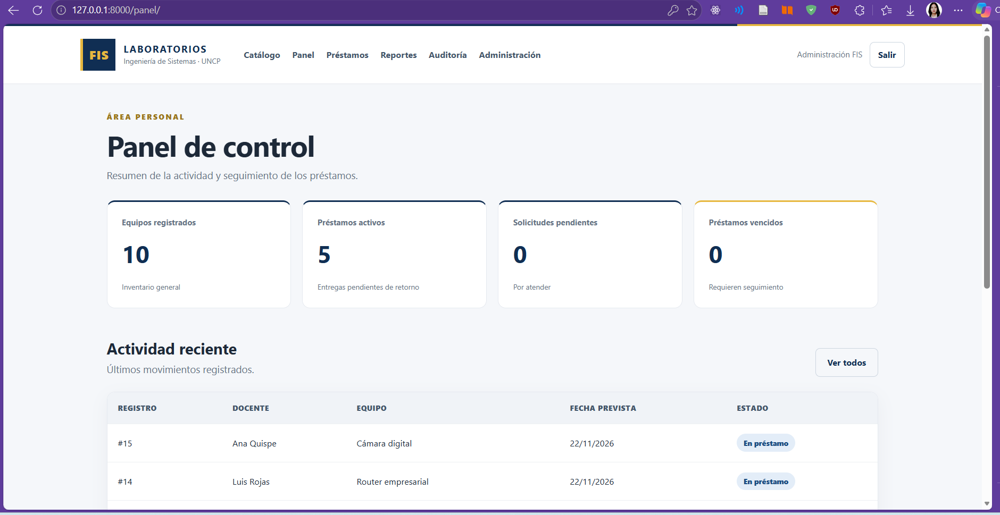

### 8.2.2. GESTIÓN DE PRÉSTAMOS: LISTADO HISTÓRICO

Consulta del historial de préstamos registrados en el sistema.

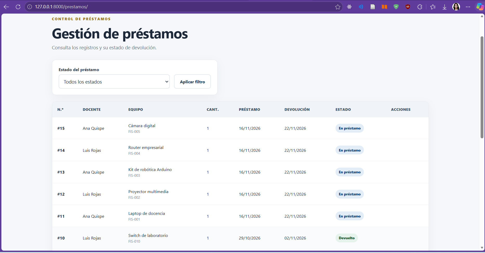

### 8.2.3. FILTRO

Aplicación de filtros en el listado de préstamos.

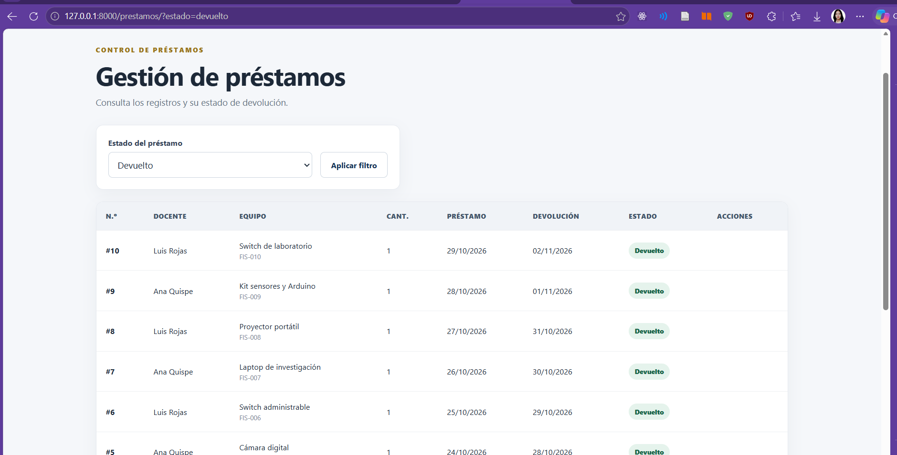

### 8.3. REPORTE DASHBOARD

Panel de reportes y estadísticas de préstamos.

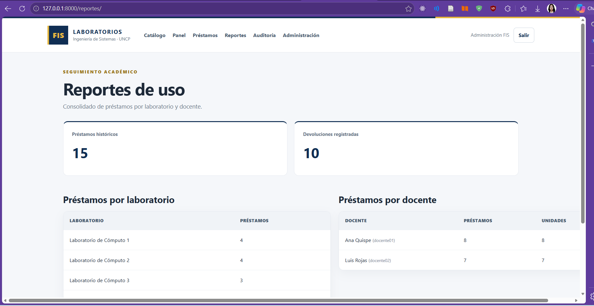

### 8.3.1. AUDITORÍA

Registro de acciones del sistema para garantizar trazabilidad.

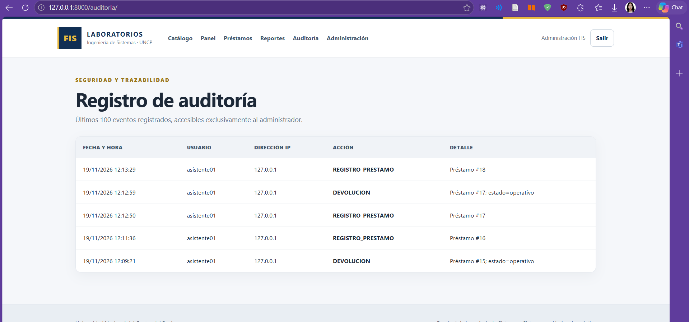

### 8.4. ACCESO INCORRECTO

Validación de acceso y respuesta ante intentos no autorizados.

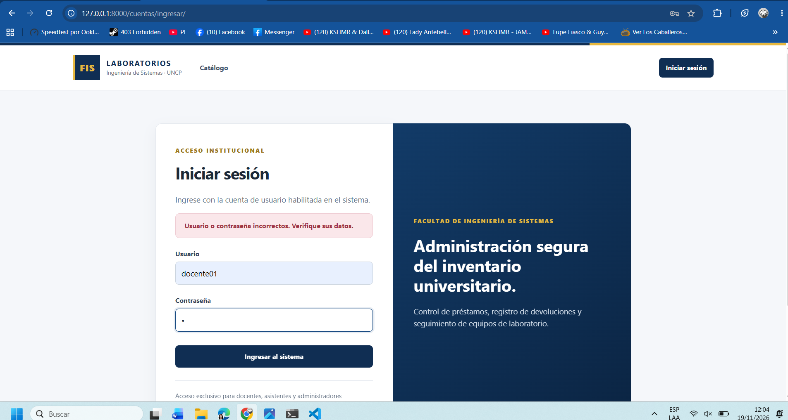

### 8.4.1. PANEL DOCENTE

Panel de control correspondiente al rol docente.

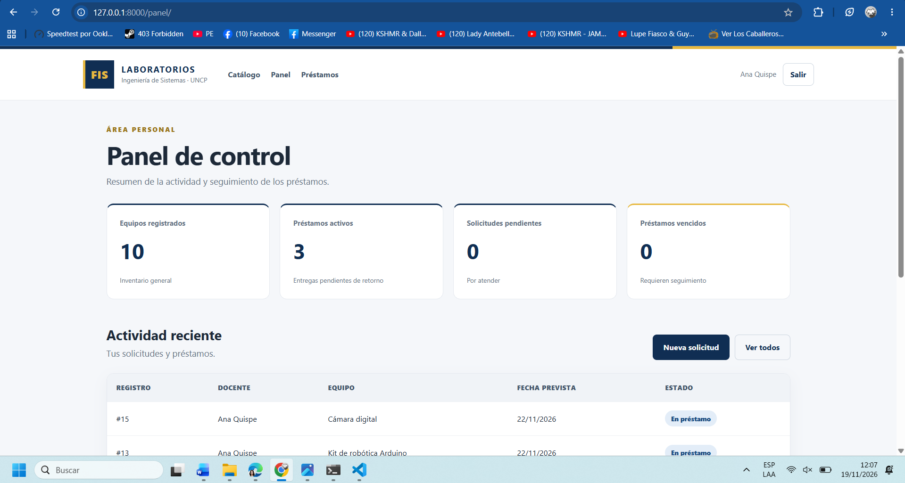

### 8.4.2. MIS PRÉSTAMOS COMO DOCENTE: MÁXIMO 3 PENDIENTES

Consulta de préstamos propios y límite de tres solicitudes o préstamos vigentes.

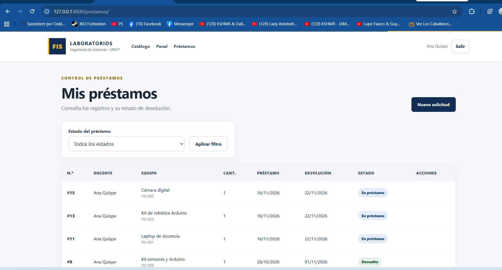

### 8.5. PANEL ASISTENTE

Vista del asistente para gestionar entregas y devoluciones.

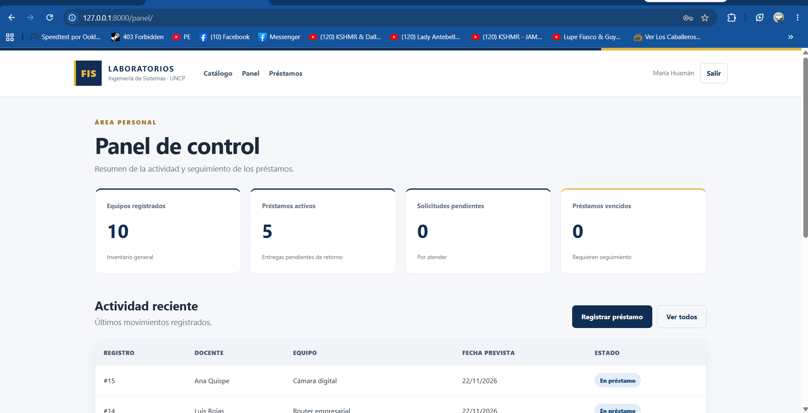

### 8.5.1. DEVOLUCIÓN REGISTRADA

Confirmación del registro de devolución de un equipo.

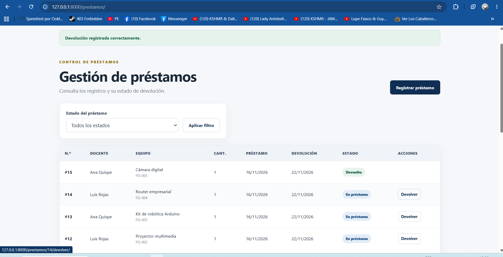

### 8.6. REGISTRO DE PRÉSTAMO

Formulario para registrar una solicitud de préstamo.

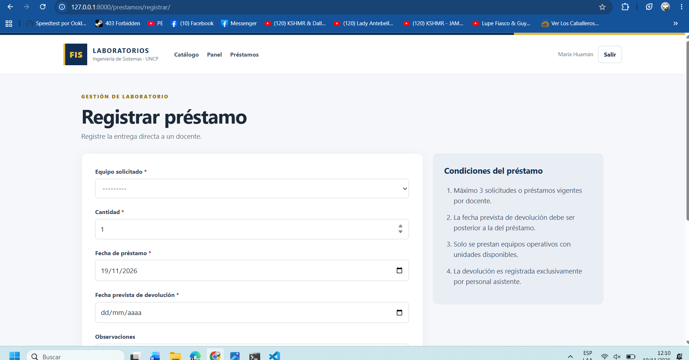

### 8.6.1. PRÉSTAMO EXITOSO

Confirmación de un préstamo registrado correctamente.

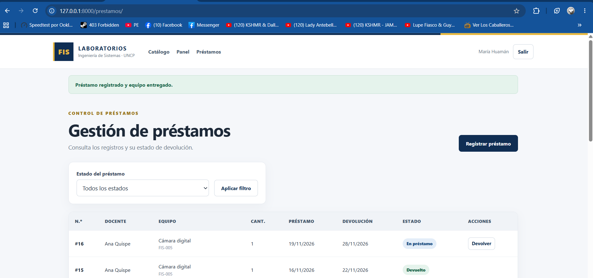

### 8.6.2. DOCENTE YA TIENE 3 PRÉSTAMOS

Validación al alcanzar el máximo de tres préstamos o solicitudes vigentes.

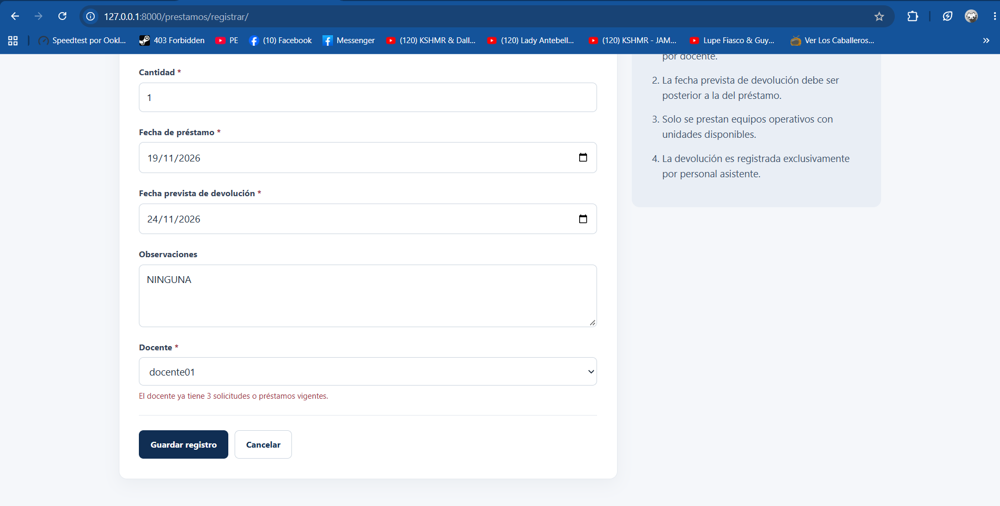

### 8.6.3. STOCK INSUFICIENTE Y FECHA OMITIDA

Mensajes de validación por stock insuficiente y ausencia de fecha requerida.


### 8.6.4. EVIDENCIA COMPLEMENTARIA 1

Captura adicional del funcionamiento del sistema.

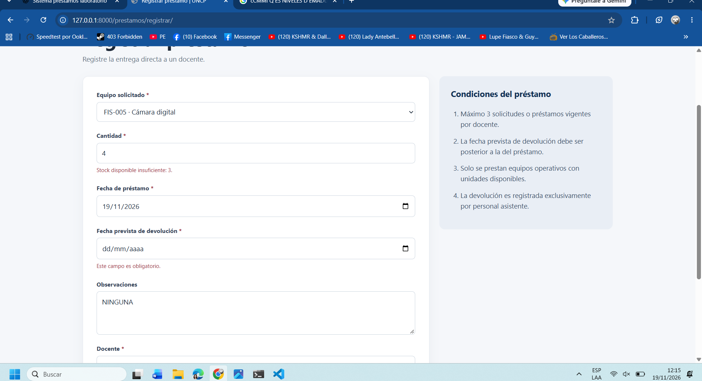
